<a name="top"></a>

<div align="center">




# Konnect-EDA *BETA Release

</div>

**AI-assisted PCB design for KiCAD 10.** Konnect is a native KiCAD plugin — a single
Rust binary — that lets Claude and other AI assistants design schematics and PCBs
through the [Model Context Protocol](https://modelcontextprotocol.io) (MCP).

**228 tools across 21 on-demand toolsets.** Schematic capture, PCB layout and
routing, ERC/DRC, design-review audits, JLCPCB part search, reference
circuits, and a full manufacturing export pipeline — with bundled skills and agents
that teach Claude KiCAD conventions out of the box.

> **Status: beta, and free to use until 1.0.** The core toolchain is tested and
> working, but this is a young release and it wants real-world mileage. Bug
> reports and feature requests are welcome in
> [Issues](https://github.com/Orchis-ai-LLC/Konnect-EDA/issues). Konnect-EDA is
> closed source; to help build it, [sign up as a contributor](https://orchis.ai/konnect/join).

> ## Add realtime research to KiCAD MCP and Konnect. Introducing Nimrod
>
> [**Nimrod**](https://nimrod.orchis.ai) is our web-research MCP server:
> quality-scored Google search, clean webpage extraction, and deep multi-source
> research. Design the board with Konnect while Nimrod pulls live parts availability, datasheets,
> and errata — no more guessing from year-old training data
>
> - Works with claude.ai, Claude Desktop, Claude Code, VS Code, and any MCP client
> - 1 credit = 1 search · extraction always free · free 50-credit trial, no card
> - Official MCP Registry: [`ai.orchis/nimrod`](https://registry.modelcontextprotocol.io)


## What it does

Instead of describing changes and applying them by hand, the AI works your project
directly:

- **Place and wire schematic components** — add resistors, ICs, connectors; wire them
  together by pin name
- **Lay out the PCB** — place, move, rotate, and route footprints in real time via
  KiCAD's IPC API, with full undo/redo integration
- **Run design checks** — ERC, DRC, connectivity validation, decoupling audits,
  power-rail review, BOM health checks
- **Export production files** — Gerbers, drill, BOM, pick-and-place, 3D models, PDF
- **Search JLCPCB parts** — find in-stock components in a local 2.5M-part catalog and
  suggest alternatives
- **Start from reference circuits** — USB-C, LDO, buck converter, STM32, I2C, LED
  templates with verified component values
- **Watch it happen** — a live schematic viewer auto-refreshes as the AI edits

## How it works

| Layer | Mechanism |
|-------|-----------|
| Schematic editing | Direct `.kicad_sch` S-expression editing with atomic writes (no KiCAD required) |
| PCB editing | KiCad 10 IPC API (NNG + protobuf) — real-time and undo-aware; single-footprint placement has a safe headless fallback |
| Specctra routing | Revision-bound Rust DSN export, local Freerouting MCP routing, and strict one-transaction SES import; an authenticated KiCad 10 native-export bridge is explicit opt-in |
| Exports & checks | `kicad-cli` subprocess (Gerber, PDF, ERC, DRC, …) |
| Transport | MCP JSON-RPC over stdio (default), or Streamable HTTP (`transport = "http"` / `"both"`) |

Explore the request path and safety boundaries in the
[interactive architecture diagrams](https://neusse.github.io/konnect-archify-tool/).

## Installation

### From the KiCAD Plugin Manager (recommended)

1. Download the package for your OS from [Releases](https://github.com/Orchis-ai-LLC/Konnect-EDA/releases):
   `konnect-pcm-v<version>-windows.zip`, `-macos.zip`, or `-linux.zip`. Each
   bundles that platform's server binary — the macOS package is a universal
   build, so one download covers Apple Silicon and Intel. (The `konnect-pcm-*`
   assets are the KiCAD plugin packages; the other archives are standalone
   server binaries.)
2. Open KiCAD 10 → **Plugin and Content Manager**
3. Click **Install from File** and select the zip
4. Restart KiCAD

Verify: open the **PCB Editor** → **Tools → External Plugins** → you should see
**Konnect**.

For KiCad 10, the Konnect settings dialog also offers an optional **native
Specctra bridge**. When enabled, `export_specctra_dsn` can ask the active PCB
Editor to generate its native DSN while Konnect still binds the export to the
exact IPC snapshot and creates the strict reverse manifest used during SES
import. The bridge is local-only, authenticated, disabled by default, and not
the KiCad 11 integration path. Konnect uses its Rust exporter by default;
`native_bridge_mode: "prefer"` enables fallback to Rust when the bridge is
unavailable, while `"require"` refuses instead.

For end-to-end autorouting, run `check_freerouting`, then
`export_specctra_dsn` → `route_specctra_dsn` →
`plan_specctra_ses_import` / `apply_specctra_ses`. Readiness reports engine
discovery, native-MCP compatibility, and complete bridge availability
separately. The owned Java child is loopback-only and is reaped on success,
failure, timeout, or cancellation. The first supported profile preserves fixed
straight tracks and through vias; unlocked routing, arcs, zones, and unsupported
geometry are rejected before mutation.

### Install guidance for your AI client

Konnect bundles shared KiCad skills for Claude and Codex. Select the client when
installing, checking, or removing that guidance:

```bash
# Existing behavior remains the default: Claude skills, agents, and hooks
konnect init

# Codex installs only the shared skills under ~/.agents/skills
konnect init --client codex
konnect status --client codex
konnect uninstall --client codex
```

MCP server startup never installs or restores guidance. Run `konnect init`
explicitly when you want those files installed; after `konnect uninstall`,
starting the server leaves them removed.

Guidance written by an older `konnect init` is not updated by upgrading the
binary. `konnect status` compares every installed skill, agent, and hook with
the bundle in the binary you run and marks each `current`, `different`, or
`missing`. The server makes the same check once for each installed version:
the first start after `konnect init` compares the files, records
the result in `~/.konnect`, and adds a one-line notice to its `initialize`
instructions if guidance is out of sync. Later starts reuse that record, so
guidance you chose to keep is not reported again. `get_installation_info`
shows the result. Re-run `konnect init` to update it.
It overwrites differing files, so keep a copy of any file you edited. `--client` remains accepted in server
commands for compatibility. For example, register a standalone binary with the
Codex CLI using:

```bash
codex mcp add konnect -- /path/to/konnect --client codex
```

Claude remains the default when `--client` is omitted. The installer tracks the
two clients independently, and a Codex install does not create or modify
`~/.claude`.

`--help` on any subcommand prints that subcommand's usage and writes nothing —
`konnect init --help` describes the installer rather than running it. An
argument Konnect does not recognise is an error rather than being ignored, so a
typo such as `--cleint codex` stops instead of quietly installing for the
default client.

To verify which Konnect process an MCP client is actually using, call the
always-visible `get_installation_info` tool. It reports the serving build,
executable path, verified installation source when one can be proven, KiCad
CLI and IPC detection, and restart guidance. A missing build commit or an
`unknown` installation source means the available evidence was insufficient;
it is not silently guessed from a directory name.

### macOS

The [Releases](https://github.com/Orchis-ai-LLC/Konnect-EDA/releases) page ships
standalone server binaries for both Apple Silicon (`aarch64-apple-darwin`) and
Intel (`x86_64-apple-darwin`). They are not yet code-signed, so if you download
one through a browser, clear the quarantine flag before first launch:

```bash
tar xzf konnect-v*-aarch64-apple-darwin.tar.gz
xattr -d com.apple.quarantine ./konnect   # only needed for browser downloads
./konnect --help
```

KiCad on macOS keeps its tools inside the app bundle and they are not on
`PATH`, so point Konnect at them in `~/Library/Application Support/konnect/config.toml`:

```toml
kicad_cli = "/Applications/KiCad/KiCad.app/Contents/MacOS/kicad-cli"
kicad_binary = "/Applications/KiCad/KiCad.app/Contents/MacOS/kicad"
# KiCad 10's IPC socket on macOS (enable it in KiCad:
# Preferences → Plugins → "Enable KiCad API")
ipc_address = "ipc:///tmp/kicad/api.sock"
```

Claude Desktop's config lives at
`~/Library/Application Support/Claude/claude_desktop_config.json`:

```json
{
  "mcpServers": {
    "konnect": {
      "command": "/path/to/konnect"
    }
  }
}
```

For Claude Code, put the same snippet in a `.mcp.json` in your project root.

The macOS PCM package (`konnect-pcm-v<version>-macos.zip`) bundles a universal
server binary, so one download covers Apple Silicon and Intel. The schematic
viewer compiles and launches on macOS (Tauri 2 uses the system WKWebView —
WebView2 is only a Windows requirement) but hasn't had the same mileage as
the Windows build yet.

## Setup with Claude Desktop

After a PCM install, the server binary lives in your KiCAD documents folder:

```
C:\Users\<YOU>\Documents\KiCad\10.0\3rdparty\plugins\com_github_mixelpixx_konnect\bin\konnect.exe
```

Edit `%APPDATA%\Claude\claude_desktop_config.json`:

```json
{
  "mcpServers": {
    "konnect": {
      "command": "C:\\Users\\<YOU>\\Documents\\KiCad\\10.0\\3rdparty\\plugins\\com_github_mixelpixx_konnect\\bin\\konnect.exe"
    }
  }
}
```

Restart Claude Desktop and the Konnect tools appear. For Claude Code, drop the same
snippet into a `.mcp.json` in your project root.

## Schematic viewer

A standalone viewer that auto-refreshes as the schematic file changes:

```bash
schematic-viewer.exe path\to\your\root_schematic.kicad_sch
```

Point it at the root sheet of a hierarchical design and every sub-sheet is rendered
too, with a depth-indented sheet selector in the toolbar. Edits saved from KiCAD (or
made by the AI through the schematic tools) re-render only the sheets that changed
and refresh the view live — rendering runs against temp-folder snapshots, so the
viewer never blocks KiCAD from saving. Pan with click-drag, zoom with the wheel,
`0` to fit, `R` to refresh, drag-and-drop to open a different file. Also launchable
by the AI via the `open_schematic_viewer` tool.

Needs the WebView2 runtime (pre-installed on Windows 10/11) and a KiCAD install for
`kicad-cli` (auto-discovered, or pass `--kicad-cli <path>`). The viewer ships in
the plugin package, beside the server binary.

## Requirements

- KiCAD 10 (Windows is the most-tested platform; macOS works from the release
  binaries — see the [macOS section](#macos) above. Linux passes the automated
  tests but hasn't had per-platform QA yet)
- `kicad-cli` (ships with KiCAD — used for exports, ERC, DRC)
- For PCB tools: KiCAD running with the target board open (IPC API)

## License

Konnect-EDA is commercial, closed-source software from Orchis.ai LLC. See
[LICENSE](LICENSE) for the full terms.

- **Free during the beta.** Until version 1.0, anyone can download and use
  Konnect-EDA free of charge, for personal or business work.
- **License keys from 1.0.** Every installation will need a license key, free
  ones included. Personal, hobby and student use stays free; business use will
  need a paid commercial license.
- **Your designs are yours.** The boards, schematics and design files you make
  with Konnect-EDA belong to you.
- **Please don't pass the downloads on.** Share a link to this page instead.

Questions about business licensing: [chris@orchis.ai](mailto:chris@orchis.ai).

## Troubleshooting

**Plugin doesn't appear in KiCAD** — install via the Plugin and Content Manager (not
manual copy), then restart KiCAD.

**PCB tools return "KiCAD must be running with the board loaded"** — open KiCAD
with that board first; most PCB tools talk to the running PCB editor. Only an
unreachable KiCAD produces that message: if KiCAD is running and the tool
refuses anyway, the error is the tool's own reason for refusing.
`place_component` can fall back to a closed board file when no KiCAD process
is reachable.

**"kicad-cli not found"** — common install paths are auto-detected; set the path
explicitly in the plugin settings dialog, in a `settings.json` beside the binary,
or in a `konnect.toml` in the working directory. (A file under any other name
works only when passed with `--config`.)

Still stuck? [Open an issue](https://github.com/Orchis-ai-LLC/Konnect-EDA/issues)
or ask on Discord.

## Support

- Community Discord: [join the Konnect community](https://discord.gg/NVp9RGMmDu)
  for installation help, AI-client setup, design-workflow discussion, and live
  project-status updates
- Bug reports and feature requests: [GitHub Issues](https://github.com/Orchis-ai-LLC/Konnect-EDA/issues)
- Contributing code: Konnect-EDA is closed source, and contributors work by
  invitation. [Sign up here](https://orchis.ai/konnect/join).
- Licensing questions: [chris@orchis.ai](mailto:chris@orchis.ai)
